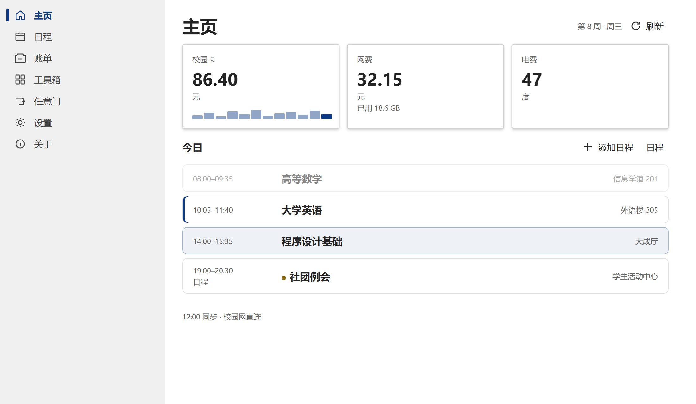
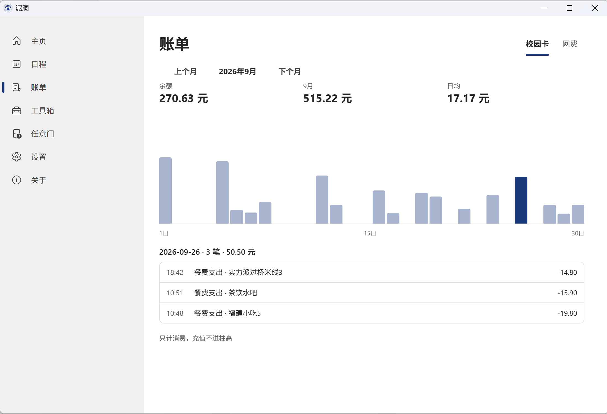
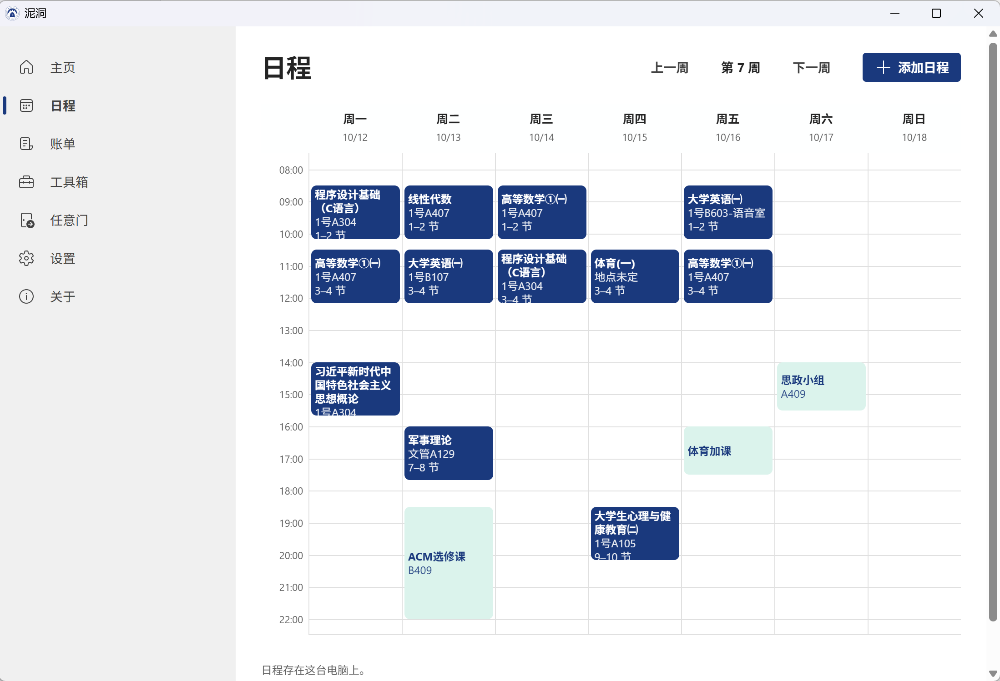

# 泥洞

东北大学私人桌面看板。一条贴在屏幕上沿的 40px 悬浮岛，平时只留下一节课、倒计时和余额警告；点一下打开主窗口，校园卡、网费、电费、课表、日程、工具箱与插件一触即达。

官网：[https://nidong.sapphirefic.tech/](https://nidong.sapphirefic.tech/)

> **声明**：泥洞是非官方工具，与东北大学及其信息化部门无关，**不适用于东北大学秦皇岛分校**。
> 程序只运行在你自己的电脑上：学号、密码、Cookie、账单、课表与日程均留在本机，不上传到任何第三方服务器。数据抓取仅使用你本人的一号通会话访问学校既有页面与接口；学校页面、接口及数据归东北大学所有，本仓库仅包含泥洞自身代码。

## 核心亮点

- **看板式信息整合**：校园卡、网费、电费与今日课程集中呈现，贴顶悬浮岛极简展示下一节课、倒计时与低余额提醒，日常不打扰。
- **课表与日程同轴**：登录后自动同步整学期课表，此后每天自动校准一次；教学周时钟视图将课程、自定义日程与插件 DDL 排在同一条时间轴上，支持到点提醒（跨天日程不支持重复）。
- **校园网自动登录，先核证再提交**：支持未联网、开机、离开指定热点或手动连上校园网时自动连接并登录。提交密码前先核对 `pass.neu.edu.cn` 的系统受信任 TLS 证书，同名仿冒网络绝不提交密码。
- **校园网免流文件分享**：在局域网内一键拉起临时文件分享页并生成随机口令，接收方直接通过电脑或手机浏览器输入口令即可下载，无需安装泥洞，双方均在校园网内时不消耗校园流量。
- **开放插件底座（WebView + MCP）**：原生支持第三方 WebView 插件、标准 MCP（Stdio）插件及混合形态。插件独立安装在本机数据目录、沙箱隔离运行，可接入工具箱面板、后台常驻巡检、悬浮岛通知与日程 DDL 指针，方便扩展作业监视器等校园效率工具。







## 更多功能与特性

- **账单与本机流量记录**：查看校园卡按自然月统计的每日花费柱状图与当日流水，翻看历史月账单；网费页提供计费说明与可选的本机校园网流量监控（区分 IPv4/IPv6、TCP/UDP 与校内/校外）。卡、网、电约每 20 分钟自动刷新。
- **宿舍电费**：在设置中绑定宿舍房间码即可查看剩余电量；每天 23:00–6:00 电费接口维护连不上时自动沿用上次缓存。
- **插件系统**：在 **工具箱 → 插件管理** 中一键导入 `.zip`、`.ndplugin` 单文件包或本地文件夹安装插件；支持启停、权限审查、MCP 连通性测试与卸载清理。插件与本体仓库及一号通凭据完全隔离，跳过登录同样可用。详见 [插件开发与适配说明](docs/插件说明.md)。
- **防社死 · 智能静音**：支持长时间无音频（20–200 分钟可调）、上课时间段或日程时间段自动静音系统默认输出设备（默认全部关闭），不动音量，手动取消静音后本段不再干预。
- **夜间定时下载**：默认预约下一个 0 点（0:00–6:00 校园网校外 IPv4 下载免流量费）自动拉取任务，支持断点续传与下载完成后自动关机。
- **任意门**：聚合常用校内官方站点与实用校外资源；校内站点在校园网直连、校外自动转 WebVPN，校园网网关仅在校园网内打开。
- **离线与跳过登录**：断网且上次未退出登录时直接进入主页并显示本地缓存（「离线状态」）；未登录也可点击「跳过登录」，照常使用日程、工具箱、任意门与插件。
- **校内 / 校外自适应**：校园网直连一卡通与教务，校外自动经学校 WebVPN 获取同一套数据。
- **本机凭据与单实例**：一号通密码存入 Windows 凭据管理器，关闭「记住密码」即刻清除；程序已在运行时再次启动会自动唤出悬浮岛并前置主窗口。

不做充值、缴费下单、挂失、选课。窗口包含 **主页、日程、账单、工具箱、任意门、设置、关于** 七项导航，点击关闭仅隐藏窗口，程序在托盘继续运行。

## 安装（Windows）

需要 64 位 Windows。

- **新安装**：前往官网 [nidong.sapphirefic.tech](https://nidong.sapphirefic.tech/)、[GitHub Releases](https://github.com/sapphire-xu/nidong/releases/latest) 或仓库 `updates/` 目录下载最新安装包（Gitee 镜像仓库同样同步发布）。安装完成后开始菜单名称为「泥洞」。
- **应用内更新**：已安装 v2.0.1 及以上版本时，打开窗口会自动静默检查更新，确认点击「更新并重启」后才会下载安装。

> 暂未支持 macOS / Linux，若愿意提供测试环境欢迎联系作者，不胜感激。

## 使用小贴士

1. **登录与验证**：使用东北大学一号通学号与密码登录；新设备若触发学校图形验证码或短信二次认证，均由本人手动填写。
2. **电费与教学周**：电费房间码在 **设置 → 宿舍与余额** 填写（留空表示未绑定）；若课表周次未自动对齐，可在 **设置 → 课表** 手动指定第一周周一。
3. **悬浮岛交互**：默认露出约 3 秒且鼠标不在岛上时自动向上收起；按快捷键（默认 `Ctrl+Q`）或在原位置悬停约 1 秒可唤出。上课前 15 分钟（可调）及开启提醒的日程会在岛上置顶提醒。运行独占全屏（D3D Exclusive）游戏时悬浮岛自动隐藏，无边框窗口化不受影响。
4. **校园网自动登录**：位于 **工具箱**，默认关闭。登录读取本机「记住密码」中的一号通凭据，状态短句显示在悬浮岛上；页面内点击「这安全吗？」可查看证书核对与防仿冒机制。
5. **免流文件分享**：位于 **工具箱**。添加文件启动后获得本机局域网网址与八位口令，双方均连校园网时浏览器直接下载不扣流量；关掉窗口继续分享，退出泥洞才停止。
6. **防社死设置**：位于 **工具箱**，默认关闭。仅控制系统默认输出设备的静音开关，不改音量，退出泥洞时自动恢复原状。
7. **定时下载**：位于 **工具箱**。粘贴 `http(s)` 链接即可预约，默认下一天 0 点开跑；若夜间断电，仅在同一个免费时段（6 点前）内自动续传，过 6 点后需手动确认「仍然继续」。下载时段请保持电脑与泥洞开启；Steam 游戏请使用 Steam 自带下载时段。
8. **插件管理与使用**：点击 **工具箱** 右上角「**插件管理**」导入 `.zip`、`.ndplugin` 插件包或本地文件夹；已启用的带界面插件会直接显示在工具箱网格中并支持状态徽标。插件支持后台常驻巡检，同步到日程表的条目按 DDL 在周视图画成红线截止指针，且不会触发智能静音；卸载插件时可选择是否同步清除其写入的日程。
9. **系统托盘**：左键单击直接打开主窗口，悬停查看卡/网/电余额（开启流量监控后同步展示 IPv4 / IPv6 实时下载速率），右键菜单支持打开窗口、刷新、复位岛与退出。

设置分为六类：**外观、宿舍与余额、课表、启动与登录、面板行为、上课提醒**，其中「启动与登录」可配置记住密码、自动登录与开机自启。

## 隐私与安全

- 所有逻辑均在你的本机运行，不接入任何第三方云端后端。
- 密码仅存于操作系统凭据管理器，不落明文 JSON、不进入 Git；关闭「记住密码」立即删除凭据（普通退出登录保留已记住的密码）。
- 抓数仅访问东北大学既有页面与接口（一号通、校园卡、缴费大厅、门户、教务、WebVPN）。
- 第三方插件运行在受限沙箱中，无法接触一号通密码、主会话 Cookie 或宿主 IPC，网络访问与日程/岛通知均按清单显式鉴权。

## 从源码开发

环境要求：Node.js 18+、Rust stable、Windows C++ Build Tools。

```bash
git clone https://github.com/sapphire-xu/nidong.git
cd nidong
npm install
npm start
```

也可直接双击仓库根目录的 `启动.bat` 启动开发模式。

- **打包发布**：运行 `scripts\publish.bat -Version x.y.z -Notes "更新说明"` 自动改版本号、使用 `%USERPROFILE%\.tauri\nidong.key`（空口令）签名打包、输出到 `updates/nidong_<版本>_x64-setup.exe` 并更新 `updates/latest.json` 后推送至 Gitee（私钥切勿提交或上传）。仅本地打包不推送请运行 `scripts\release.bat`。
- **调试时钟**：测试上课提醒或定时逻辑可用 `scripts\set-now.bat` 覆盖程序时间，测完运行 `scripts\clear-now.bat` 恢复，详见 [docs/给AI.md](docs/给AI.md)。

## 文档导航

修改本体功能建议先读 [docs/给AI.md](docs/给AI.md)；抓取学校数据须遵循 [docs/开发文档.md](docs/开发文档.md) 中的实测接口；界面设计以 [docs/视觉设计.md](docs/视觉设计.md) 为准；开发或适配插件请参阅 [docs/插件说明.md](docs/插件说明.md)。文档与代码冲突时，以代码和 `给AI.md` 为准。

| 文档 | 面向读者 | 内容摘要 |
|---|---|---|
| [docs/给AI.md](docs/给AI.md) | 后续 AI / 维护者 | 现行架构、窗口状态机、各模块位置与修改约束 |
| [docs/插件说明.md](docs/插件说明.md) | 插件开发者 / 宿主维护者 | 插件底座架构、打包与 `plugin.json` 规范、权限、`window.nidong` SDK 与 MCP Stdio 规范 |
| [docs/视觉设计.md](docs/视觉设计.md) | 视觉 / 前端样式 | 品牌气质、色彩 Token、尺寸规范、状态表现与禁止项 |
| [docs/开发文档.md](docs/开发文档.md) | 抓数与认证维护 | 已实测的东大各业务接口、认证流程与缓存策略 |
| [docs/prototype/index.html](docs/prototype/index.html) | 历史对照 | 早期展开岛原型，非现行界面规格 |

## 致谢与许可

- 本项目源码基于 [MIT](LICENSE) 许可开源。学校页面、接口和数据归东北大学所有，本仓库仅覆盖泥洞自身代码。
- 界面组件来自 Fluent UI React（Copyright (c) Microsoft Corporation，MIT），图标来自 Fluent System Icons（MIT）；动效时长参考 WinUIonWeb，与微软无关。
- 提醒铃声 Argon 来自 Android 开源工程，按 Apache-2.0 分发，许可全文与来源说明见 [src-tauri/windows/Argon-NOTICE.txt](src-tauri/windows/Argon-NOTICE.txt)（安装后与程序同目录）。

官网：[https://nidong.sapphirefic.tech/](https://nidong.sapphirefic.tech/) · 联系作者：[xufeiyang@mails.neu.edu.cn](mailto:xufeiyang@mails.neu.edu.cn)
