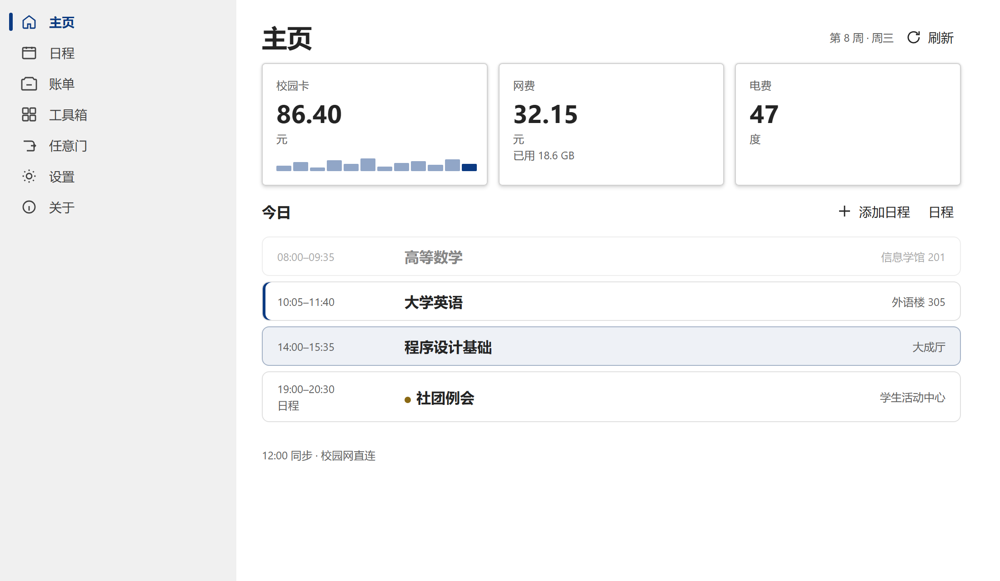

# 泥洞

东北大学桌面看板。悬浮岛贴在屏幕上沿，点一下打开看板窗口，所有信息一触即达。

非官方工具，与东北大学及其信息化部门无关。

只在你自己的电脑上运行。学号、密码、cookie、账单和课表都留在本机，不上传到任何非东北大学官方服务器。抓取用的是你自己的一号通，只访问学校已经提供的页面和接口。学校的页面、接口和数据归东北大学，本仓库只包含泥洞自己的代码。

不适用于东北大学秦皇岛分校。



主页示例用的是虚构课程和余额，图里没有真实姓名。

## 独有优势

- **看板式信息整合**：校园卡、网费、电费和今日课程收在同一块看板上。贴顶岛只留一节课、倒计时和余额警告。
- **课程日程触手可及**：登录后获取整学期课表，每天自动同步一次。日程和课程显示在同一条周视图上，到点前悬浮岛会提醒。日程存在这台电脑上，不和智慧东大同步。
- **校园网自动登录，安全快捷**：可以在未联网、开机、离开指定网络，或自己连上校园网时连接并登录。密码只在学校登录页的证书核对通过后加密发送。同名网络对不上证书时，密码不会提交。

## 还有这些功能&特性

- **账单**：校园卡本月花费和当日流水，以及网费计费说明。卡、网、电大约 20 分钟自动刷新。
- **宿舍电费**：在设置里填房间码后显示余量。每天约 23:00–6:00 电费系统经常连不上，同步失败就显示上次缓存。
- **离线**：没网时若上次没退出登录，窗口直接进主页，并提示「离线状态」。
- **任意门**：直达官方网站和民间信息聚合网站。学校站点在校园网直连，人在校外时改走 WebVPN。校园网网关只能在校园网里开。浏览器不带泥洞自己的登录状态。
- **校内 / 校外**：校园网直连一卡通和教务；校外先走学校 WebVPN 再拉数据。
- **本机凭据**：一号通学号密码进 Windows 凭据管理。关掉「记住密码」会删掉密码。
- **单实例**：已经在跑时再打开，会叫出岛并打开窗口。

不做充值、缴费下单、挂失、选课。学校改接口时抓数层可以换，界面不绑死某一版 URL。

窗口里是主页、日程、账单、工具箱、任意门、设置、关于。关掉窗口只是藏起来。

## 安装（Windows）

需要 64 位 Windows。已经装了 2.0.1 或更高版本的，打开窗口会检查到新版本，点「更新并重启」才下载。也可以从 [GitHub Releases](https://github.com/sapphire-xu/nidong/releases) 下载安装包。新安装用 Gitee 仓库 `updates` 目录里的 `nidong_2.1.0_x64-setup.exe`，或同一份 GitHub Release。装好后开始菜单里的名字是「泥洞」。

macOS 安装包这一版还没有。

## 使用时容易漏掉的

1. 学号、密码是东北大学一号通。新设备可能要图形验证码和短信，都由本人填写。
2. 电费房间码在 **设置 → 宿舍与余额**，和学校电费页是同一个。留空表示还没绑定。
3. 课表日期周次未自动对齐：**设置 → 课表**，填本学期第一周的周一。
4. 岛默认自动隐藏。露出来约 3 秒、鼠标不在岛上时，收进屏幕上沿。Ctrl+Q（可改），或在原位置悬停约 1 秒，只把岛叫出来。上课前 15 分钟（可改）岛上弹出一条置顶提醒，开了提醒的日程同样到点弹出。
5. 校园网自动登录在 **工具箱**，默认关闭。登录用「记住密码」里的一号通密码，提示出现在岛上。点「这安全吗？」可以看它怎么防仿冒网络。
6. 托盘左键直接打开窗口。右键菜单还可以查看校园卡、网费、电费余额。

独占全屏游戏（D3D Exclusive）时岛会自动藏起。无边框窗口化游戏可以被岛盖住。

设置里是六类：外观、宿舍与余额、课表、启动与登录、面板行为、上课提醒。启动与登录里可以开关记住密码、自动登录、开机自启。

## 隐私

- 只跑在你自己的电脑上。
- 密码进系统凭据，不进普通 json，也不进 git。
- 抓数只打学校已经提供的页面和接口（一号通、校园卡、缴费大厅、门户、教务、WebVPN）。
- 退出登录不会清掉已记住的密码。关闭记住密码时删除。

## 从源码开发

需要 Node 18+、Rust stable、Windows C++ Build Tools。

```bash
git clone https://github.com/sapphire-xu/nidong.git
cd nidong
npm install
npm start
```

或双击仓库根目录的 `启动.bat`。首次仍用一号通学号密码登录。

打带更新签名的 Windows 安装包：双击 `scripts\release.bat`。它读取 `%USERPROFILE%\.tauri\nidong.key`（口令为空）再打包。这把私钥不要提交，也不要上传到 Gitee 或 GitHub。没有它时直接 `npx tauri build` 会失败。

产物在 `src-tauri/target/release/bundle/nsis/`，旁边有同名 `.sig`。发布到 Gitee 时，把安装包放到 `updates/nidong_<版本>_x64-setup.exe`，把 `.sig` 全文写进 `updates/latest.json`。同一份安装包也发到 GitHub Releases，方便直接下载。清单版本要高于正在使用的版本。已经装了 v2.0.0 的人需要手动再装一次带更新功能的版本，之后打开窗口会自己检查，点「更新并重启」才下载。

测上课提醒可以把「现在」拨到开课前：`scripts\set-now.bat`，测完 `scripts\clear-now.bat`。说明见 [docs/给AI.md](docs/给AI.md)。

## 文档

改功能从给 AI 那份开始。抓数只能按开发文档里**已实测**的接口写。界面气质以视觉设计为准。有冲突时信代码和给 AI。`docs/界面改造计划.md` 和 `docs/prototype/` 是已经落地之前的稿，不要照着改。

| 文件 | 给谁 | 内容 |
|---|---|---|
| [docs/给AI.md](docs/给AI.md) | 后续 AI / 接手的人 | 当前程序怎么跑、状态机、改哪里 |
| [docs/视觉设计.md](docs/视觉设计.md) | 视觉 / 写 CSS | 气质、token、尺寸、状态、禁止项 |
| [docs/开发文档.md](docs/开发文档.md) | 抓数 | 已实测的东大接口、认证、缓存策略 |
| [docs/prototype/index.html](docs/prototype/index.html) | 历史对照 | 旧的展开岛。现行界面不看它 |

界面控件来自 Fluent UI（MIT）。动效时长参考 WinUIonWeb，与微软无关。

## 许可

[MIT](LICENSE)。学校的页面、接口和数据归东北大学，本仓库只覆盖泥洞自己的代码。

反馈：[xufeiyang@mails.neu.edu.cn](mailto:xufeiyang@mails.neu.edu.cn)。
