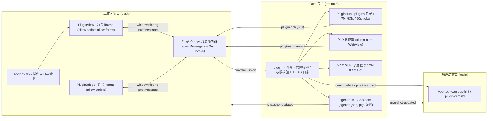

# 泥洞 · 插件底座与开发规范

本文说明泥洞（`edu.neu.nidong`）当前的插件宿主架构、本体各模块如何适配插件，以及第三方插件（WebView 插件 / MCP Stdio 插件）的打包、清单、权限与接口规范。

产品整体运行约束见 [给AI.md](给AI.md)，视觉气质与色彩语义见 [视觉设计.md](视觉设计.md)。本文以现有实现代码（`src-tauri/src/plugin.rs`、`ui/src/desk/pages/Plugins.tsx` 等）为准。

---

## 1. 设计目标与隔离原则

泥洞插件底座支持两类运行形态（及二者的混合）：

- **WebView 插件（`webview`）**：以单文件 HTML 跑在工作区 `desk` 内的沙箱 `<iframe>` 中，通过宿主注入的 `window.nidong` SDK 与 Rust 后端通信，可拥有独立面板、后台常驻巡检、私有存储、私有 Cookie Jar、日程写入和悬浮岛通知能力。
- **MCP Stdio 插件（`mcp`）**：对接标准 Model Context Protocol（JSON-RPC 2.0 over Stdio）本地子进程，向宿主或混合插件暴露工具列表与工具调用能力。
- **混合插件（`hybrid`）**：同时具备 WebView 前端面板与 MCP Stdio 后端能力。

核心隔离原则：

1. **代码与仓库隔离**：插件统一安装在用户本机数据目录 `%APPDATA%\edu.neu.nidong\plugins\<plugin-id>\`，不进入泥洞本体 Git 仓库。
2. **凭据与会话隔离**：插件无法读取泥洞的一号通账号密码、OS Keyring 或学校 CAS 会话 Cookie；每个插件拥有独立的 `storage.json` 与 `cookies.json`。
3. **沙箱与白名单权限**：WebView 插件运行在无 `allow-same-origin` 的受限 `<iframe>` 中，无法直接调用 Tauri IPC；所有宿主调用必须经由 `PluginBridge` 转发，并在 Rust 侧重新校验插件启用状态与 `plugin.json` 权限声明。
4. **不依赖一号通登录**：插件底座随工作区初始化即可运行，未登录或选择「跳过登录」时，工具箱中的插件管理与已启用插件照常可用。

---

## 2. 本项目如何适配插件（宿主架构）

### 2.1 整体调用链路



### 2.2 本体代码分布

| 模块 | 文件 | 职责 |
|---|---|---|
| Rust 插件宿主 | `src-tauri/src/plugin.rs` | 清单解析与 ID/路径校验、安装/启停/卸载、桥接脚本与主题变量注入（`build_plugin_srcdoc`）、私有存储与 Cookie Jar、HTTP 代理、独立认证窗口、MCP Stdio 客户端、日志管理、60 秒脉冲及全部 21 个 `plugin_*` Tauri 命令 |
| 应用启动与注册 | `src-tauri/src/lib.rs` | `setup` 中执行 `app.manage(plugin::PluginHub::open(data_dir))` 与 `plugin::spawn_ticker(...)`，并在 `invoke_handler` 注册全部 `plugin::*` 命令 |
| 前端 IPC 封装 | `ui/src/api.ts` | 声明 `PluginManifest`、`PluginInfo`、`McpConfig`、`PluginHttpRequest`、`PluginHttpResponse` 类型及 `api.plugin*` 调用方法 |
| 通信桥与管理页 | `ui/src/desk/pages/Plugins.tsx` | 提供 `PluginBridge`（全局消息桥 + 后台常驻容器）、`PluginView`（前台 iframe 容器）与 `PluginManagerPanel`（安装、启停、MCP 测试、卸载） |
| 工作区顶层接入 | `ui/src/desk/DeskApp.tsx` | 初始化拉取 `api.pluginList()`、监听 `plugins-updated` 事件、将 `plugins`/`theme`/`activePluginId` 传给 `Toolbox` 并常驻挂载 `PluginBridge` |
| 工具箱入口 | `ui/src/desk/pages/Toolbox.tsx` | 页眉提供「插件管理」按钮；将 `enabled && hasUi` 的插件渲染为工具箱瓷贴（含状态徽标 `statusBadge`），点击进入 `plugin:<id>` 子页 |
| 悬浮岛通知接入 | `ui/src/App.tsx` | 监听 `plugin-remind` 触发 10 秒置顶提醒（跟随铃声设置）；复用 `campus-hint` 显示短句提示 |
| 日程与 DDL 适配 | `ui/src/agenda.ts`、`ui/src/desk/pages/Schedule.tsx` | 识别 `plg:` 前缀日程为截止点（DDL），在周视图渲染红线指针、在主页按截止时间排序与标示 |
| 智能静音排除 | `src-tauri/src/smart_mute.rs` | `active_agenda_key` 跳过 `plg:` 前缀日程，避免截止点误触发系统静音 |
| 窗口配置与 CSP | `src-tauri/tauri.conf.json` | `desk` 窗口开启 `"backgroundThrottling": "disabled"` 保证隐藏后后台插件仍正常响应；全局 CSP 限制插件不能外连 CDN |
| 插件样式 | `ui/src/desk/desk.css` | `.plugin-*`、`.tool-badge`、`.ddl-pointer` / `.ddl-knob` 样式定义 |

### 2.3 本机目录与持久化布局

```text
%APPDATA%\edu.neu.nidong\
  agenda.json                   # 泥洞本机日程真源（插件日程以 plg:<plugin-id>: 开头）
  plugins\
    registry.json               # 启停状态：{ "disabled": ["<plugin-id>", ...] }
    <plugin-id>\
      plugin.json               # 插件清单（必需）
      ui\index.html             # 前端入口（示例路径，由 manifest.entry 指定）
      storage.json              # 插件私有 KV 存储（按需创建）
      cookies.json              # 插件私有 Cookie Jar（按需创建）
      plugin.log                # 插件运行日志（按需创建，超 1MB 自动保留尾部约 512KB）
```

说明：
- **状态徽标（`statusBadge`）** 仅存于内存 `PluginHub.badges`，重启泥洞或停用插件后清空，需由插件在启动或巡检时重新设置。
- **卸载插件** 时会删除整个 `plugins\<plugin-id>\` 目录并清理 `registry.json` 与内存徽标；用户可在确认框中决定是否同时清除 `agenda.json` 中所有 `plg:<plugin-id>:` 条目（默认勾选）。

### 2.4 与泥洞核心功能的联动规则

1. **后台常驻与前后台切换**
   - `desk` 窗口在启动时创建（`visible: false`），关闭窗口只是隐藏，且配置了 `"backgroundThrottling": "disabled"`。
   - `PluginBridge` 挂载在 `DeskApp` 顶层，为所有满足 `enabled && hasUi && manifest.background && id !== activePluginId` 的插件渲染隐藏 `<iframe>`。
   - **重要**：当用户点开某后台插件的面板时，`activePluginId` 匹配该插件，**后台 `iframe` 会卸载并切换为前台 `PluginView`；退出面板后前台卸载、后台重新挂载**。同一时刻不会并存两个同 ID 实例，但页面 JS 内存状态会在切换时重置。
   - Rust 侧 `plugin::spawn_ticker` 每 60 秒向前端广播一次 `plugin-tick`（携带 `clock::now().to_rfc3339()`），`PluginBridge` 会将其转发给当前所有已挂载的前/后台插件 `iframe`。

2. **插件日程的特殊联动（DDL 语义）**
   - 插件通过 `window.nidong.agenda.upsert` 写入的日程，ID 会被强制规范为 `plg:<plugin-id>:<raw-id>`。
   - 宿主当前将所有 `plg:` 前缀日程（以及名称以 `[MOOC` 或 `[DDL` 开头的日程）视作 **DDL 截止点日程**（见 `ui/src/agenda.ts` 的 `isDdlAgenda`）：
     - **周视图（`Schedule.tsx`）**：不占课程/日程时间块，而是按 `end` 时刻（钳制在 `07:30–22:30` 时间轴内）在对应日期列绘制一条红色水平指针与右侧圆点；相隔 ≤ 2 分钟的多个 DDL 自动合并到同一指针气泡中，点击可编辑。
     - **主页列表（`agenda.ts` 的 `mixDay`）**：按 `end` 排序，时间列显示 `HH:MM 截止`，状态文案为「已截止」或「距截止 · N 分钟」（不进入「还剩 N 分钟」的进行中状态）。
     - **防社死 · 智能静音（`smart_mute.rs`）**：显式过滤 `!id.starts_with("plg:")`，插件日程**不会**触发「日程自动静音」。
     - **悬浮岛提醒（`App.tsx`）**：`upcomingAgenda` 仍按日程的 `start` 时刻减去 `remindMinutes` 触发岛上提醒。

3. **悬浮岛通知**
   - `island.hint(text)` 复用 `campus-hint` 通道：唤出悬浮岛显示短句，默认 4 秒后自动消退；若文案以 `"正在"` 开头则持续停留，直到新提示替换。
   - `island.remind({ name, start })` 发送 `plugin-remind`（`kind: "event"`）：悬浮岛置顶提醒 10 秒；若用户在设置中开启了提醒铃声，会按设定音量播放 Argon 铃声。

### 2.5 如何在本体中新增插件宿主能力

若后续要向插件开放新能力，按以下 5 步保持前后端与安全边界一致：

1. **Rust 实现与权限校验（`src-tauri/src/plugin.rs`）**：
   - 新增 `#[tauri::command]` 函数，首行通过 `require_enabled_manifest` 校验插件已安装且启用；如涉及敏感能力，使用 `has_permission` 或域名白名单校验。
   - 在 `BRIDGE_SCRIPT_TEMPLATE` 的 `window.nidong` 对象上增加对应方法，内部走 `callHost("<action>", payload)`。
2. **注册命令（`src-tauri/src/lib.rs`）**：将新命令加入 `tauri::generate_handler![...]`。
3. **前端 API 封装（`ui/src/api.ts`）**：补充 `api.plugin*` 的 `invoke` 封装及 TypeScript 类型。
4. **消息桥路由（`ui/src/desk/pages/Plugins.tsx`）**：
   - 同步请求：在 `dispatchPluginCall` 的 `switch (action)` 中增加分支。
   - 宿主推送事件：在 `PluginBridge` 中 `listen(...)` 对应 Tauri 事件并向所有 `.plugin-frame, .plugin-bg-frame` 广播 `{ __nidongPluginEvent: true, type, pluginId?, payload }`，同时在 `BRIDGE_SCRIPT_TEMPLATE` 中增加对应监听器。
5. **验证**：在 `src-tauri` 运行 `cargo test --lib`，在仓库根目录运行 `npx tsc --noEmit`。

**宿主改造安全红线**：
- 不得给插件 `<iframe>` 添加 `allow-same-origin` 或暴露 `window.__TAURI__`。
- 权限校验必须在 Rust 命令侧完成，不能只依赖前端 `PluginBridge` 判断。
- 不得把一号通密码、Keyring 凭据或泥洞主 Cookie 透传给插件。

---

## 3. 插件打包与安装规范

在工作区进入 **工具箱 → 插件管理**，支持三种安装方式：

| 方式 | 文件/目录形态 | 升级覆盖时的用户数据保留 |
|---|---|---|
| 单文件插件包 | `.ndplugin` 或 `.json`（`PluginBundle` JSON 格式） | 原地覆盖 `plugin.json` 与 `files`，保留已有 `storage.json`、`cookies.json`、`plugin.log` |
| 压缩包 | `.zip`（根层或单层子目录内含 `plugin.json`） | 解压后走目录安装，保留已有 `storage.json`、`cookies.json`（`plugin.log` 会重置） |
| 本地文件夹 | 含 `plugin.json` 的目录（或选中其中的 `plugin.json` 文件） | 同上；复制时自动忽略 `.git`、`node_modules`、`target` |

### 3.1 `.ndplugin` 单文件包格式

`.ndplugin` 本质是 UTF-8 编码的 JSON 文件（零依赖跨平台分发），结构对应 `PluginBundle`：

```json
{
  "manifest": {
    "id": "edu.neu.plugin.example",
    "name": "示例插件",
    "version": "0.1.0",
    "author": "your-name",
    "description": "插件功能简介",
    "runtime": "webview",
    "entry": "ui/index.html",
    "background": false,
    "permissions": ["island:notify"]
  },
  "files": {
    "ui/index.html": "<!doctype html><html>...</html>"
  }
}
```

路径规范（`sanitize_rel_path`）：
- `entry` 与 `files` 中的路径必须为相对路径，使用 `/` 分隔（Windows `\` 会自动规范化）。
- 禁止空路径、以 `/` 开头、包含 `.` 或 `..` 路径段。

---

## 4. 清单文件 `plugin.json` 规范

所有插件根目录都必须包含合法的 UTF-8 JSON 文件 `plugin.json`，键名统一使用 **camelCase**：

| 字段 | 类型 | 必填 | 默认值 | 规范说明 |
|---|---|---|---|---|
| `id` | `string` | 是 | — | 全局唯一 ID，长度 **1–80**；仅允许 ASCII 字母、数字、`.`、`-`、`_`；不得以 `.` 开头，不得含 `..`。推荐反向域名风格，如 `edu.neu.plugin.xxx` |
| `name` | `string` | 是 | — | 插件展示名称（去空白后不能为空） |
| `version` | `string` | 是 | — | 插件版本号，建议使用 SemVer（如 `"1.0.0"`）。升级时请递增版本号，后台容器依赖 `id@version` 触发重载 |
| `author` | `string` | 否 | `""` | 作者名称 |
| `description` | `string` | 否 | `""` | 简短描述，显示在插件管理列表卡片上 |
| `runtime` | `string` | 否 | `"webview"` | 运行形态：`"webview"`（纯界面/后台）、`"mcp"`（纯 MCP 服务）、`"hybrid"`（界面 + MCP） |
| `entry` | `string \| null` | 否 | `null` | WebView 入口 HTML 相对路径（如 `"ui/index.html"`）。仅当文件真实存在时 `hasUi = true`，才会在工具箱显示瓷贴 |
| `background` | `boolean` | 否 | `false` | 是否启用后台常驻。需同时具备有效 `entry` 才会加载后台隐藏 `iframe` |
| `permissions` | `string[]` | 否 | `[]` | 权限声明数组，大小写不敏感 |
| `mcp` | `McpConfig \| null` | 否 | `null` | MCP Stdio 配置：`{ "command": "...", "args": [...], "env": { ... } }` |

### 4.1 权限声明清单

插件应遵循**最小权限原则**，仅声明实际需要的权限（插件管理卡片会向用户明文展示）：

| 权限字符串 | 授权范围 | 匹配规则与说明 |
|---|---|---|
| `agenda:write` | `window.nidong.agenda.upsert` / `delete` | 精确匹配（忽略大小写）。只读 `agenda.list` 不需要此权限 |
| `island:notify` | `window.nidong.island.hint` / `remind` | 精确匹配（忽略大小写） |
| `http:<host>` | `window.nidong.http.fetch`、`auth.openWindow`、`openExternal` | 仅允许 `http://` 与 `https://` URL。<br/>• 精确域名：`http:api.example.com`<br/>• 通配子域：`http:*.example.com`（同时匹配 `example.com` 及任意多级子域，不匹配 `evil-example.com`）<br/>• 全局通配：`http:*`（**不推荐**，仅调试或确需访问任意域名时使用） |
| `mcp:stdio` | `window.nidong.mcp.listTools` / `call` | 建议显式声明以便用户审查（当前宿主校验条件为插件已启用且配置了 `mcp` 字段，后续可能收紧为强制校验） |

以下基础能力受目录隔离保护，**无需**在 `permissions` 中声明（仅需插件处于已启用/已安装状态）：
- `setBadge`
- `storage.get` / `storage.set`
- `agenda.list`（仅可见本插件自己的 `plg:<id>:` 条目）
- `auth.getCookies` / `auth.setCookies`
- `log.append` / `log.open`

---

## 5. WebView 插件开发规范

### 5.1 沙箱与单文件约束（必读）

宿主通过 `build_plugin_srcdoc` 读取 `manifest.entry` 指向的 HTML 文本，直接作为 `<iframe srcDoc={...}>` 渲染：

- 前台 `sandbox="allow-scripts allow-forms"`
- 后台 `sandbox="allow-scripts"`

由此带来以下硬性约束：

1. **必须单文件自包含**：`srcDoc` 无本地文件系统基址，相对路径的 `<script src="./app.js">`、`<link href="./style.css">`、`` 均无法加载。CSS 与 JS 需内联在入口 HTML 中，图标/图片使用内联 SVG 或 `data:` URI（也可在开发期使用打包工具如 Vite + `vite-plugin-singlefile` 构建出单文件）。
2. **禁止外链 CDN 资源**：宿主 CSP（`default-src 'self'`）会拦截外部脚本、样式表、网络字体和普通外网图片。
3. **禁止直接 `fetch()` / `XMLHttpRequest` 访问外网**：沙箱为不透明源（opaque origin）且受 CSP `connect-src` 限制，所有网络请求必须调用 `window.nidong.http.fetch(...)`。
4. **禁止使用 `localStorage` / `sessionStorage` / `document.cookie`**：无 `allow-same-origin` 时访问浏览器本地存储会抛出 `SecurityError`，状态必须走 `window.nidong.storage` 与 `window.nidong.auth`。
5. **表单与弹窗**：不要依赖 `window.open`（打开外链请用 `window.nidong.openExternal`）或原生阻塞弹窗 `alert`/`confirm`/`prompt`，请在页面内自绘轻量交互。

### 5.2 主题适配规范

宿主在加载 HTML 时会自动在 `<html>` 上设置 `data-theme="light"` 或 `data-theme="dark"`，并在 `</head>` 前注入 `<style id="nidong-plugin-theme">`（用户切换主题时也会同步更新 `data-theme` 并触发 `onTheme` 回调）。

可直接使用的注入 CSS 变量：

| CSS 变量 | 浅色默认值 | 深色默认值 | 建议用途 |
|---|---|---|---|
| `--bg-page` | `#fafafa` | `#141820` | 页面底色（`body` 默认 `transparent`） |
| `--bg-raised` | `#ffffff` | `#1c222c` | 卡片 / 面板容器底色 |
| `--bg-island` | `rgba(244, 247, 251, 0.88)` | `rgba(18, 22, 28, 0.78)` | 浮层 / 半透明强调底 |
| `--ink` | `#1a2433` | `#e8eef6` | 主文字 |
| `--ink-dim` | `#5c6b80` | `#93a1b5` | 次要说明文字 |
| `--neu-blue` | `#0b3a82` | `#6fa2ff` | 品牌主色、主按钮、强调元素 |
| `--neu-blue-deep` | `#07285c` | `#3d6fd4` | 悬停 / 按压态 |
| `--ok` | `#1f7a4d` | `#5bd49a` | 成功 / 正常状态 |
| `--warn` | `#c45a12` | `#f0a35a` | 警告 / 临近截止 |
| `--danger` | `#b42318` | `#ff7a72` | 错误 / 危险操作 |
| `--agenda` | `#147a6e` | `#8fd4c6` | 日程小点与青绿强调 |
| `--agenda-bg` | `#d5f4ec` | `#8fd4c6` | 状态药丸 / 标签底色 |
| `--agenda-ink` | `#0b3a82` | `#06231f` | 状态药丸文字色 |
| `--stroke` | `rgba(10, 30, 60, 0.10)` | `rgba(255, 255, 255, 0.10)` | 卡片描边与分割线 |

建议遵循泥洞视觉原则：布局清爽克制，适配工作区最小宽度（880px，减去左侧导航后内容区约 680px 起）及容器高度（`calc(100vh - 120px)`，最小高 `440px`），页面内部自行处理纵向滚动。

### 5.3 `window.nidong` 桥接 API 参考

宿主在 `</head>` 前注入 `<script id="nidong-plugin-bridge">`，页面脚本加载后即可直接访问 `window.nidong`。除属性与事件注册外，所有方法均返回 `Promise`。

#### 基础属性与徽标

```ts
window.nidong.pluginId: string;

// 设置工具箱瓷贴和插件管理卡片上的状态药丸；传 null 或空串清除
window.nidong.setBadge(badge: string | null): Promise<void>;
```

#### 私有 KV 存储（`storage.json`）

```ts
// 读取键；不存在时返回 null
window.nidong.storage.get(key: string): Promise<any>;

// 写入任意可 JSON 序列化的值；传 null 删除该键
window.nidong.storage.set(key: string, value: any): Promise<void>;
```

#### 日程读写（`agenda.json`）

```ts
// 仅返回本插件写入的日程（已按 plg:<pluginId>: 过滤）
window.nidong.agenda.list(): Promise<Agenda[]>;

// 新增或按 id 覆盖更新；需权限 agenda:write；返回本插件最新日程列表
window.nidong.agenda.upsert(item: Agenda): Promise<Agenda[]>;

// 删除指定日程（支持传原始短 id 或完整 plg:<pluginId>:... id）；需权限 agenda:write
window.nidong.agenda.delete(id: string): Promise<Agenda[]>;
```

`Agenda` 对象字段与宿主校验规则（`src-tauri/src/agenda.rs`）：

| 字段 | 类型 | 必填 | 校验要求 |
|---|---|---|---|
| `id` | `string` | 是 | 传稳定业务键如 `"hw_1001"`，宿主自动幂等补全为 `plg:<pluginId>:hw_1001`；空串会随机生成 ID（不利于幂等更新，不推荐） |
| `name` | `string` | 是 | 名称，去空白后非空 |
| `start` | `string` | 是 | 本地时间 `YYYY-MM-DDTHH:MM`（必须严格早于 `end`） |
| `end` | `string` | 是 | 本地时间 `YYYY-MM-DDTHH:MM`（对插件 DDL 日程，**`end` 即截止时刻**） |
| `location` | `string` | 否 | 地点或课程归属说明，最多 80 字符 |
| `note` | `string` | 否 | 备注信息 |
| `remind` | `boolean` | 是 | 是否开启悬浮岛到点提醒 |
| `remindCode` | `string` | `remind=true` 时必填 | 提醒提前量代码：`"1"`（1 分钟）、`"2"`（10 分钟）、`"15"`（15 分钟）、`"3"`（30 分钟）、`"4"`（1 小时）、`"5"`（2 小时）、`"6"`（1 天）、`"7"`（前一天指定时刻） |
| `setTime` | `string` | `remindCode="7"` 时必填 | 前一天的提醒时刻，格式 `HH:MM`（如 `"20:00"`） |
| `isRepet` | `boolean` | 否 | 是否重复，默认 `false`；开启时不允许跨天 |
| `repetRule` | `object` | `isRepet=true` 时必填 | `{ freq: "DAILY" \| "WEEKLY", byday?: ("Mo"\|"Tu"\|"We"\|"Th"\|"Fr"\|"Sa"\|"Su")[], endmode: "DATE" \| "NUMBER", time?: "YYYY-MM-DD", num?: 1..999 }` |

> **DDL 日程写法建议**：由于 `plg:` 前缀日程在周视图和主页均按 `end` 作为截止点展示、而悬浮岛提醒按 `start` 计算提前量，且后端强制校验 `end > start`：建议将 `end` 设为真实截止时刻，将 `start` 设为截止前 15–30 分钟（例如截止 `23:59` 时设 `start: "YYYY-MM-DDT23:30"`, `end: "YYYY-MM-DDT23:59"`），并配合 `remindCode`（如 `"5"` 提前 2 小时或 `"6"` 提前 1 天）触发岛上提醒。

#### 悬浮岛通知（需权限 `island:notify`）

```ts
// 在悬浮岛中部显示短句提示；普通句子 4 秒自动清除，以「正在」开头会停留至被替换
window.nidong.island.hint(text: string): Promise<void>;

// 在悬浮岛置顶提醒 10 秒（支持传字符串或对象）；用户开启铃声时会响 Argon
window.nidong.island.remind(
  opts: string | { name: string; start?: string }
): Promise<void>;
```

#### HTTP 代理请求（需权限 `http:<host>`）

```ts
window.nidong.http.fetch(req: {
  url: string;
  method?: string;                  // 默认 "GET"
  headers?: Record<string, string>;
  body?: string;
}): Promise<{
  status: number;
  headers: Record<string, string>;
  body: string;
  cookies: Record<string, string>;  // 请求后的最新插件 Cookie Jar
}>;
```

行为说明：
- 由 Rust `reqwest` 直连发送（`no_proxy()`，不走系统代理），单次超时 **20 秒**，默认 User-Agent 为桌面端 Chrome。
- 自动携带本插件 `cookies.json`；若请求头里手动传了 `Cookie`，会先解析合并进 Jar 再发送。响应头中的 `Set-Cookie` 会自动合并（空值删除）并持久化到 `cookies.json`。
- 若未指定 `Referer` / `Origin`，自动按目标 URL 的 `scheme://host/` 与 `scheme://host` 补全。

#### 外部认证窗口与 Cookie Jar

```ts
// 打开独立登录认证窗口（需权限 http:<host>）；url 请务必显式传入
window.nidong.auth.openWindow(opts: {
  url: string;
  username?: string;
  password?: string;
}): Promise<void>;

// 读取本插件 cookies.json
window.nidong.auth.getCookies(): Promise<Record<string, string>>;

// 写入/合并/清空本插件 cookies.json
// - 传 null 或 ""：清空所有 Cookie
// - 传 "a=1; b=2"：解析并合并（自动忽略 Path/Domain/Expires/Max-Age/SameSite/Secure/HttpOnly）
// - 传 { a: "1", b: null }：非空字符串写入，null 或 "" 删除该键
window.nidong.auth.setCookies(
  cookies: Record<string, string | null> | string | null
): Promise<Record<string, string>>;
```

> **关于 `auth.openWindow` 的当前现状**：独立窗口（标签 `plugin-auth`，980×680）打开后会监听文档标题变化，当页面标题变为 `__NIDONG_AUTH_OK__:<cookieString>` 时，Rust 宿主会自动结合 `cookies_for_url(origin)` 拉取完整 Cookie（含 `HttpOnly`）写入 `cookies.json`、发出 `onAuth({ status: "success", cookies })` 并关闭窗口；若用户直接关窗则发出 `onAuth({ status: "closed" })`。**目前内置的自动填表与登录成功检测脚本针对 `icourse163.org`（网易 URS / `STUDY_INFO`）特化**；其他站点若使用此窗口，在底座扩展通用完成回调机制前，建议结合手动 Cookie 粘贴（`auth.setCookies`）或通过 `http.fetch` 完成登录流程。

#### MCP 调用、日志与外部链接

```ts
// 列出 manifest.mcp 配置的 MCP 服务工具（JSON-RPC tools/list）
window.nidong.mcp.listTools(): Promise<any>;

// 调用 MCP 工具（JSON-RPC tools/call）
window.nidong.mcp.call(tool: string, args?: Record<string, any>): Promise<any>;

// 追加一行文本到 plugins/<plugin-id>/plugin.log（超 1MB 自动保留后半约 512KB）
window.nidong.log.append(line: string): Promise<void>;

// 用系统默认程序打开 plugin.log
window.nidong.log.open(): Promise<void>;

// 用系统浏览器打开 http(s) 链接（需权限 http:<host>）
window.nidong.openExternal(url: string): Promise<void>;
```

#### 宿主推送事件

```ts
// 每 60 秒触发一次；isoNow 为 RFC3339 时间戳（遵循泥洞调试时钟 dev-now.txt / NIDONG_NOW）
window.nidong.onTick(fn: (isoNow: string) => void): void;

// 泥洞深浅色切换时触发；回调前宿主已自动更新 <html data-theme="...">
window.nidong.onTheme(fn: (theme: "light" | "dark") => void): void;

// auth.openWindow 完成登录或被关闭时触发（宿主已按 pluginId 过滤）
window.nidong.onAuth(
  fn: (ev: { pluginId: string; status: "success" | "closed"; cookies?: Record<string, string> }) => void
): void;
```

### 5.4 生命周期与后台巡检最佳实践

- **状态及时落盘**：后台插件在用户打开/关闭前台面板时会销毁并重建 `iframe`。初始化时应从 `window.nidong.storage.get(...)` 恢复状态；任何配置变更或同步结果应立即写回 `storage`。
- **用 `onTick` 驱动轮询**：后台定时任务应优先挂在 `window.nidong.onTick` 上并自行按 `lastSyncAt` 节流（例如每 15–30 分钟拉一次远端接口，避免每分钟高频打目标站），同时天然兼容泥洞的时钟覆盖测试工具（`scripts/set-now.bat`）。
- **区分前后台渲染开销**：同一份 `entry` HTML 既可能在前台展示也可能在后台运行，可结合 `document.visibilityState` 或视口尺寸（后台容器 `display: none`，`window.innerWidth === 0`）跳过纯视觉动画与非必要 DOM 重绘。
- **幂等写入日程**：给外部任务构造稳定的 `id`（如 `hw_<远端ID>`），每次同步对比 `agenda.list()`，更新变更项、删除已完成或过期项，避免产生重复 DDL。

---

## 6. MCP Stdio 插件规范

泥洞原生内置了轻量的标准 **MCP（Model Context Protocol）JSON-RPC 2.0 over Stdio** 客户端（`run_mcp_stdio`），支持纯 MCP 插件（`runtime: "mcp"`）和混合插件（`runtime: "hybrid"`）。

### 6.1 `plugin.json` 中的 `mcp` 字段

```json
{
  "id": "edu.neu.plugin.demo-mcp",
  "name": "示例 MCP 工具",
  "version": "0.1.0",
  "runtime": "mcp",
  "permissions": ["mcp:stdio"],
  "mcp": {
    "command": "node",
    "args": ["C:/path/to/server.mjs"],
    "env": {
      "NODE_ENV": "production"
    }
  }
}
```

用户可在 **工具箱 → 插件管理** 中点击插件卡片上的「**测试 MCP**」按钮，实时校验 `tools/list` 返回结果。

### 6.2 协议交互流程与硬性约束

每次调用 `mcp.listTools()` 或 `mcp.call(tool, args)` 时，宿主会执行以下流程：

1. 启动子进程（Windows 下带 `CREATE_NO_WINDOW` 标志隐藏黑窗，`stderr` 重定向到 `null`）。
2. 向 `stdin` 写入一行 `initialize` 请求（`id: 1`，`protocolVersion: "2024-11-05"`）并读取 **1 行** `stdout` 作为握手响应。
3. 写入 `notifications/initialized` 通知。
4. 写入 `tools/list` 或 `tools/call` 请求（`id: 2`），从 `stdout` 逐行读取（最多扫描 32 行），匹配到 `id === 2` 的 JSON 行后提取 `result`（或返回 `error`），随即终止子进程。

因此 MCP 插件服务端必须满足：

- **严格单行 NDJSON over stdio**：每条 JSON-RPC 消息必须序列化为单行并以 `\n` 结尾并 flush，禁止输出多行美化 JSON 或 `Content-Length` HTTP 帧。
- **保持 `stdout` 干净**：调试日志必须写到 `stderr` 或文件，绝对不能输出到 `stdout`（否则会破坏第 2 步的单行握手读取）。
- **轻量、无常驻内存依赖**：当前底座采用单次调用拉起/销毁模式，进程不应依赖内存态跨调用保持上下文；需要持久化时应自行读写文件，或采用 `hybrid` 形态由 WebView 侧通过 `window.nidong.storage` 维护状态。
- **命令路径明确**：当前启动子进程时未将工作目录切换到插件安装目录，建议 `command` 使用系统 `PATH` 中可用的可执行文件或绝对路径。

---

## 7. 最小可用示例

### 7.1 最小 WebView 插件（目录结构）

```text
my-demo-plugin/
  plugin.json
  ui/
    index.html
```

`plugin.json`：

```json
{
  "id": "edu.neu.plugin.demo-ddl",
  "name": "DDL 小助手",
  "version": "0.1.0",
  "author": "demo",
  "description": "演示存储、主题、日程写入与悬浮岛提醒的最小插件",
  "runtime": "webview",
  "entry": "ui/index.html",
  "background": true,
  "permissions": ["agenda:write", "island:notify"]
}
```

`ui/index.html`（单文件自包含）：

```html
<!doctype html>
<html lang="zh-CN">
<head>
  <meta charset="utf-8" />
  <title>DDL 小助手</title>
  <style>
    * { box-sizing: border-box; }
    body { padding: 16px; background: var(--bg-page); }
    .card {
      background: var(--bg-raised);
      border: 1px solid var(--stroke);
      border-radius: 8px;
      padding: 16px;
      max-width: 560px;
    }
    h2 { margin: 0 0 8px; font-size: 16px; }
    p { margin: 0 0 12px; color: var(--ink-dim); font-size: 13px; }
    .row { display: flex; gap: 8px; flex-wrap: wrap; }
    button {
      padding: 6px 14px;
      border-radius: 6px;
      border: 1px solid var(--stroke);
      background: var(--bg-raised);
      color: var(--ink);
      cursor: pointer;
    }
    button.primary {
      background: var(--neu-blue);
      border-color: var(--neu-blue);
      color: #fff;
    }
    button.primary:hover { background: var(--neu-blue-deep); }
  </style>
</head>
<body>
  <div class="card">
    <h2>DDL 小助手</h2>
    <p id="status">正在初始化…</p>
    <div class="row">
      <button class="primary" id="btn-add">写入示例 DDL</button>
      <button id="btn-hint">发一条岛上提示</button>
      <button id="btn-log">打开日志</button>
    </div>
  </div>
  <script>
    const statusEl = document.getElementById("status");

    async function refreshStatus() {
      const list = await window.nidong.agenda.list();
      await window.nidong.setBadge(list.length ? `${list.length} 项待办` : null);
      statusEl.textContent = `当前插件已同步 ${list.length} 条 DDL 日程。`;
    }

    document.getElementById("btn-add").onclick = async () => {
      const d = new Date(Date.now() + 2 * 3600 * 1000);
      const pad = (n) => String(n).padStart(2, "0");
      const day = `${d.getFullYear()}-${pad(d.getMonth() + 1)}-${pad(d.getDate())}`;
      const start = `${day}T${pad(d.getHours())}:${pad(d.getMinutes())}`;
      const endDate = new Date(d.getTime() + 30 * 60 * 1000);
      const endDay = `${endDate.getFullYear()}-${pad(endDate.getMonth() + 1)}-${pad(endDate.getDate())}`;
      const end = `${endDay}T${pad(endDate.getHours())}:${pad(endDate.getMinutes())}`;

      await window.nidong.agenda.upsert({
        id: "demo-1",
        name: "[DDL] 实验报告提交",
        location: "示例课程",
        note: "由示例插件写入",
        start,
        end,
        remind: true,
        remindCode: "3"
      });
      await window.nidong.log.append(`[${new Date().toISOString()}] 已写入示例 DDL`);
      await refreshStatus();
    };

    document.getElementById("btn-hint").onclick = () =>
      window.nidong.island.hint("DDL 小助手运行正常");

    document.getElementById("btn-log").onclick = () =>
      window.nidong.log.open();

    window.nidong.onTick(async (isoNow) => {
      await window.nidong.storage.set("lastTick", isoNow);
      await refreshStatus();
    });

    refreshStatus().catch((e) => {
      statusEl.textContent = `初始化失败：${e.message || e}`;
    });
  </script>
</body>
</html>
```

在泥洞中打开 **工具箱 → 插件管理 → 从文件夹安装**，选中 `my-demo-plugin` 目录即可安装体验。

---

## 8. 当前底座的已知边界与演进注意点

开发插件或维护泥洞底座时，需了解以下现行实现的边界条件：

1. **WebView 单文件限制**：`plugin_load_html` 仅读取入口 HTML 文本并通过 `srcDoc` 渲染，尚无自定义协议（如 `plugin://`）来提供多文件静态资源。
2. **`http.fetch` 与 `auth.openWindow` 的内置站点兼容钩子**：
   - `plugin_http_fetch` 对包含 `.rpc` 的 URL 会自动尝试从 Jar 注入 `csrfKey=<NTESSTUDYSI>`，对包含 `/dwr/call/plaincall/` 的请求体会替换 `httpSessionId=__NTESSTUDYSI__`。
   - `plugin_open_auth_window` 当前内置的自动填充与登录完成信号脚本针对 `icourse163.org` 特化。
   - 后续接入更多第三方站点时，应优先抽离为声明式配置，不要在 Rust 宿主里继续堆叠单一站点特判。
3. **HTTP 请求固定直连**：`plugin_http_fetch` 使用 `no_proxy()` 且固定 20 秒超时，不走系统代理，也不支持自定义超时或二进制流下载。
4. **插件日程一律按 DDL 处理**：当前 `isDdlAgenda` 与 `smart_mute.rs` 直接按 `id.startsWith("plg:")` 判定，因此插件暂时只能写入 DDL 截止点语义的日程，尚不支持写入「占时间块且参与智能静音」的普通时段日程。
5. **MCP 短连接模式与工作目录**：每次 MCP 调用都会重新拉起并在收到结果后立即终止子进程，且未把 `cwd` 切换到插件目录。
6. **前后台切换不共享 JS 内存**：打开/关闭插件前台面板会触发前后台 `iframe` 互斥切换与重新加载，需要持久化的数据务必写入 `window.nidong.storage`。
